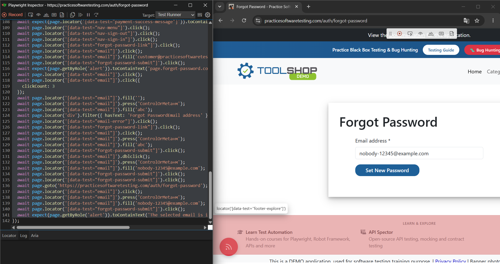
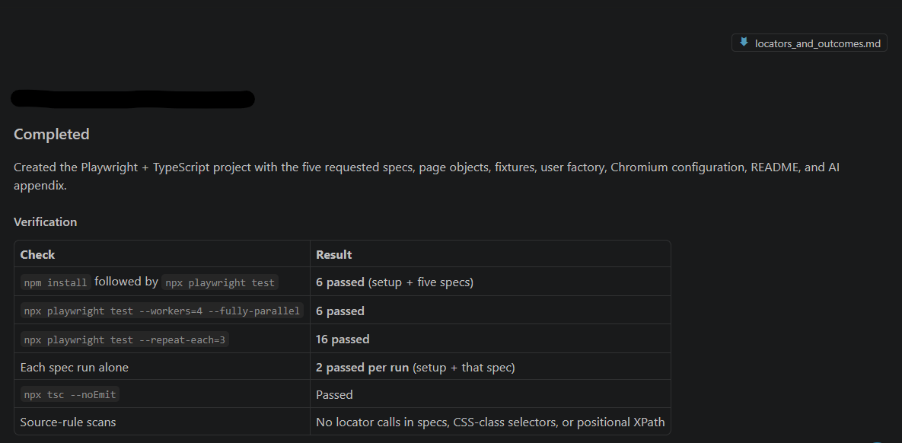

## First reply of AI to my first prompt:

'''I stopped before creating the project because the brief says not to invent locators if the live site can’t be inspected sufficiently.

The Toolshop page loaded, but product data subsequently disappeared: the catalogue showed no products, and the browser reported repeated 401 Unauthorized errors. I could verify these current registration selectors: register-form, first-name, last-name, dob, country, postal_code, house_number, street, city, state, phone, email, password, and register-submit. I also verified the forgot-password selectors forgot-password-form, email, and forgot-password-submit, plus the login form’s accessible labels and “Login” button.

I could not verify the product-detail, cart, or checkout locators, or the actual success/error outcomes needed for the login and password-reset assertions. Those are the specific gaps preventing a reliable suite. Please provide the missing locators and observed outcomes from codegen or DevTools, or let me know when the site is working again; then I can continue.'''

## So I launch PlayWright Inspector via command in terminal 'npx playwright codegen https://practicesoftwaretesting.com' and manually tested(clicked..)

## Then copy all the locators and outcomes from PlayWright Inspector and ask Claude to give me structured file with locators and ready methods for page objects, following required conf like 'testIdAttribute: 'data-test''

## As a reply, got the locators_and_outcomes.md --- which I used to continue generating suites

